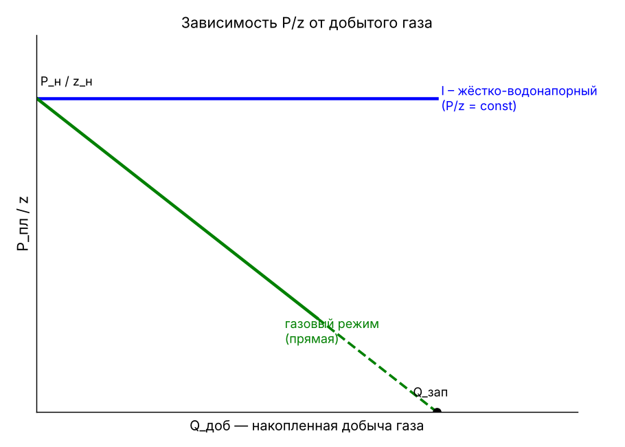

# КР-1 — ОТВЕТЫ (все 10 вопросов)

## 1. Что такое разработка газовых и газоконденсатных месторождений?
Под разработкой газовых и газоконденсатных залежей понимается **управление процессами движения в пласте газа и газоконденсата к скважинам с целью добычи газа и конденсата**. Такое управление достигается посредством определённой **системы разработки залежи**.
**Система разработки** — это размещение необходимого числа эксплуатационных (и нагнетательных), наблюдательных и пьезометрических скважин, порядок ввода их в эксплуатацию и поддержание определённых, допустимых технологических режимов эксплуатации скважин.
Основной параметр, определяющий эффективность разработки, — **пластовое давление**, его контроль и управление его локальными изменениями через дебиты скважин.

## 2. Назовите отличия запасов категории C1 от запасов категории B1.
- **C1 (разведанные)** — запасы залежей (частей залежей) **разведываемых** месторождений, **не введённых в промышленную разработку**. На них может проводиться только **пробная эксплуатация** участков (групп скважин) или отдельных скважин после бурения. Проектного документа на разработку нет.
- **B1 (разрабатываемые, неразбуренные, разведанные)** — запасы на **разрабатываемых** месторождениях: части залежей, **ещё не разбуренные эксплуатационными скважинами**, разработка которых **планируется по утверждённому проектному документу** (технологической схеме или технологическому проекту разработки). Они изучены сейсморазведкой и разбурены поисковыми, оценочными, разведочными, транзитными или углублёнными эксплуатационными скважинами, давшими **промышленные притоки** газа (нефти).
- **Главные отличия:**
  1. C1 — на **разведываемых** месторождениях, B1 — на **разрабатываемых**;
  2. для B1 есть **утверждённый проектный документ** на разработку, для C1 — нет (только пробная эксплуатация);
  3. основание для перевода C1 → B1 — **рентабельность по проекту разработки**. В этом коренное отличие классификации 2013 г. (действует с 01.01.2016) от прежних;
  4. подтверждаемость: B1 — **90–95 %**, C1 — **75–80 %**.

## 3. Нарисуйте график жёстко-водонапорного и газового режимов работы газовой залежи.
**НАРИСОВАТЬ:**

**Как рисовать:**
- Ось Y — **P_пл/z** (приведённое пластовое давление), ось X — **Q_доб** (накопленный объём добытого газа). На оси Y отметить начальную точку **P_н/z_н**.
- **Жёстко-водонапорный режим** — **горизонтальная прямая** из точки P_н/z_н: P/z = const. Давление не падает, потому что весь объём отобранного газа замещается водой.
- **Газовый режим** — **наклонная прямая** из той же точки вниз до оси X. Конец можно провести пунктиром: экстраполяция до P/z = 0 даёт запасы газа Q_зап.
- (Дополнительно: между ними лежат кривые **смешанного (упруго-водонапорного) режима**, выпуклые вверх.)

**Подписи к графику:**
- **Газовый режим:** приток газа идёт за счёт упругой энергии сжатого газа, вода в залежь практически не поступает. Признаки: прямолинейная зависимость P_пл/z от Q_доб; давление (уровни) в пьезометрических скважинах не меняется; положение ГВК не меняется.
- **Жёстко-водонапорный режим:** в залежь поступает контурная или подошвенная вода и **полностью замещает** объём отобранного газа, пластовое давление не снижается. Признаки: зависимость P/z от Q_доб отклоняется от прямой (при жёстком — горизонталь); падение давления (подъём уровней) в пьезометрических скважинах; перемещение ГВК; обводнение скважин.

## 4. Какие физико-химические свойства/параметры природного газа нужно определить перед разработкой?
- **Компонентный состав газа** (в том числе неуглеводородные примеси: N₂, CO₂, H₂S, He) и **влагосодержание**;
- **пластовые давление и температура**;
- **критические (псевдокритические) давление и температура**;
- **фазовые превращения газовой смеси** (для ГК — давление начала конденсации, выпадение конденсата);
- **коэффициент сверхсжимаемости z** — отношение объёма реального газа к объёму идеального при тех же P и T; уравнение состояния PV = zRT;
- **плотность** (и относительная плотность по воздуху) и **вязкость** газа в пластовых условиях;
- **условия гидратообразования** (влагосодержание, равновесные P и T образования гидратов);
- **теплофизические свойства** — теплоёмкость, теплопроводность.

## 5. Какие методы подсчёта запасов газа применяются на газовых месторождениях?
1. **Объёмный метод** — применим **на любой стадии** разведки и разработки. Основан на определении давления, газонасыщенности, пористости и геометрических размеров газоносной части пласта:
   V = F · h · m · f · (P·α − P_к·α_к) · β_г · η_г,
   где F — площадь газоносности, h — толщина, m — пористость, f — температурная поправка, P и P_к — начальное и конечное давление, α = 1/z — поправка на отклонение от закона Бойля–Мариотта, β_г — газонасыщенность, η_г — коэффициент газоотдачи.
2. **Метод падения пластового давления (материального баланса)** — применяют **при опытно-промышленной эксплуатации и разработке**. Основан на уравнении материального баланса. Точнее всего отражает реальные особенности месторождения и проще объёмного метода. **Недостаток:** для точной оценки нужно отобрать **5–6 % начальных запасов**:
   Q_извл = (Q₂ − Q₁)·(P₂α₂ − P_кα_к) / (P₁α₁ − P₂α₂).
3. **Создание геологической (3D) модели** — объёмный метод с учётом сложной геометрии и изменения P/T условий. Применяют при наличии достаточной исходной информации.

## 6. Какие трубы входят в конструкцию эксплуатационной скважины (названия)?
1. **Направление** — самая короткая верхняя колонна, перекрывает неустойчивые верхние отложения;
2. **Кондуктор** — перекрывает верхние водоносные горизонты, на нём устанавливается противовыбросовое оборудование;
3. **Промежуточная (техническая) колонна** — при необходимости, перекрывает осложнённые интервалы;
4. **Эксплуатационная колонна** — спускается до продуктивного пласта, цементируется, связь с пластом через перфорационные отверстия;
5. **НКТ — насосно-компрессорные (фонтанные, лифтовые) трубы** — спускаются внутрь эксплуатационной колонны, по ним газ поднимается на поверхность.

Обсадные колонны цементируются (цементный камень за колонной). Сверху — колонная головка и фонтанная арматура.

## 7. Перечислите методы проведения газогидродинамических исследований скважин на стационарном режиме фильтрации.
1. **Метод установившихся отборов** — на каждом режиме ждут полной стабилизации забойного давления и дебита, между режимами — полного восстановления давления; 5–6 режимов. Недостаток: большие потери газа и длительность.
2. **Изохронный метод** — различные депрессии на пласт задают за **один и тот же промежуток времени**, между режимами ждут **полного** восстановления давления до пластового.
3. **Ускоренно-изохронный метод** — депрессии задают за один и тот же промежуток времени, ждут **неполного (95–98 %)** восстановления давления.
4. **Экспресс-метод** — **время задания депрессии равно времени (неполного) восстановления давления**. Работа на режиме не более 20–30 мин, минимальная продолжительность испытаний.
5. **Метод монотонно-ступенчатого изменения дебита** — депрессии задают за один и тот же промежуток времени, между режимами скважину останавливают на **непродолжительное время (120–180)** и задают следующую депрессию.

Цель исследований на стационарных режимах — получить индикаторную зависимость p²_пл − p²_з = aQ + bQ² и обосновать технологический режим эксплуатации скважин.

## 8. Что такое технологический режим эксплуатации скважины?
- **По ГОСТ Р 55415-2013:** технологический режим работы скважины — **совокупность параметров, характеризующих устойчивую работу скважины (добывающей, нагнетательной) и устанавливаемых с учётом различных ограничений**.
- Технологическим режимом эксплуатации газовых скважин называется **такой режим, при котором обеспечивается максимально возможный дебит скважины в условиях действия ограничивающих факторов при соблюдении техники безопасности и экологических норм и правил данного региона**.
- Иначе: это **рассчитанное изменение во времени дебита, давления, температуры и состава газа на устье скважины при принятом условии отбора газа на забое скважины**.

Основная задача установления технологического режима — обоснование дебита проектных скважин. От дебита зависят число скважин, их обвязка и экономические показатели разработки.

## 9. Перечислите виды/критерии технологического режима эксплуатации газовых скважин.
**Виды:** **фактический** (устанавливает геологическая служба промысла ежеквартально или раз в полгода) и **расчётный** (устанавливается в проектах разработки на много лет вперёд).

**Критерии (условия отбора газа на забое)** — математическая запись фактора, ограничивающего дебит:
1. **Постоянный градиент давления на забое, dP/dR = const** — пласт неустойчивый или слабоустойчивый, есть опасность разрушения призабойной зоны;
2. **Постоянная депрессия на пласт, ΔP = P_пл − P_з = const** — опасность обводнения пластовой (подошвенной, контурной) водой, деформация коллектора, смятие колонны;
3. **Постоянное забойное давление, P_з = const** — газоконденсатные месторождения, чтобы не выпадал конденсат;
4. **Постоянный дебит, Q = const** — нет опасности прорыва воды и разрушения пласта; поддержание плановых отборов;
5. **Минимально необходимая скорость газа на забое, V_з ≥ V_кр (V_з > 4 м/с)** — вынос жидкости и песка с забоя, предотвращение песчано-жидкостной пробки;
6. **Максимально допустимая скорость газа на устье, V_у < 11 м/с** — коррозионно-активные компоненты (CO₂, H₂S), эрозия, вибрация;
7. **Постоянное устьевое давление, P_у = const** — при запаздывании ввода ДКС, при низких давлениях;
8. **Температурный режим, T = const** — при опасности гидратообразования.

**Факторы выбора режима:** геологические, технические, технологические, экономические.

## 10. Что должны предусмотреть проектные технологические документы на разработку месторождений?
1. **Обеспечение добычи** находящихся на государственном балансе **извлекаемых запасов** газа, конденсата и содержащихся в них сопутствующих компонентов;
2. **Достижение максимально возможного извлечения** сырьевых ресурсов;
3. **Выполнение обязательств пользователя недр** в соответствии с условиями **лицензии** на пользование недрами и требованиями **законодательства РФ о недрах**.

(Дополнительно: вариант разработки выбирают по технико-экономическому обоснованию — по КИГ, КИК и ЧДД.)
